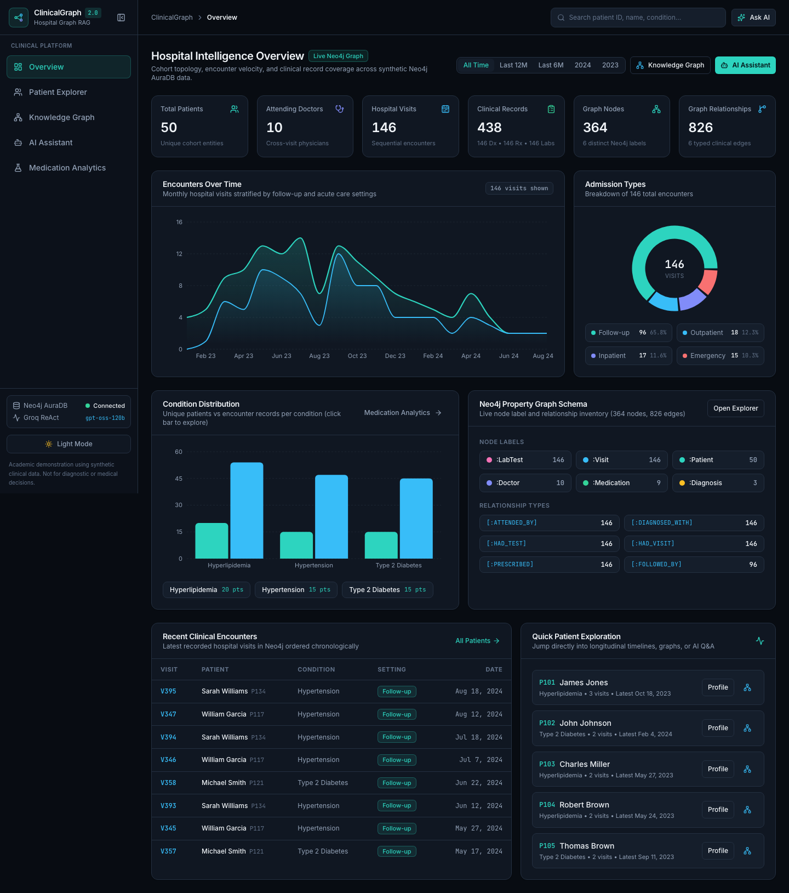
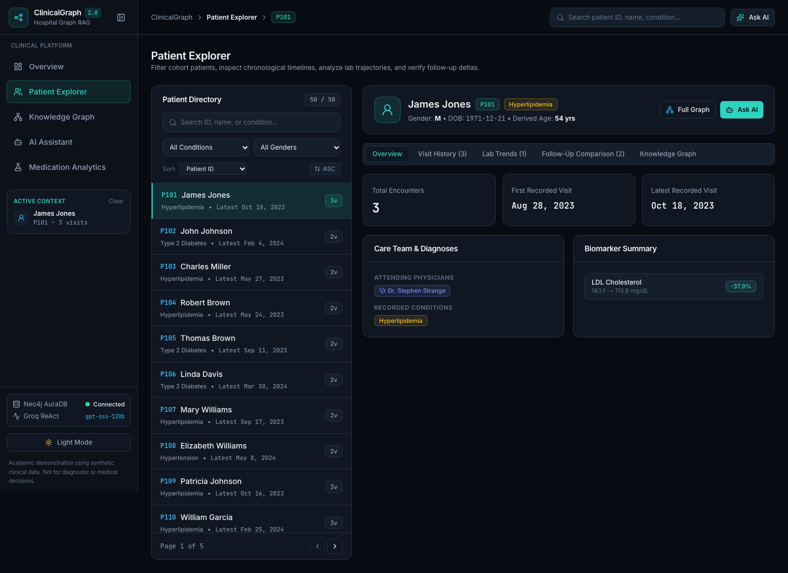
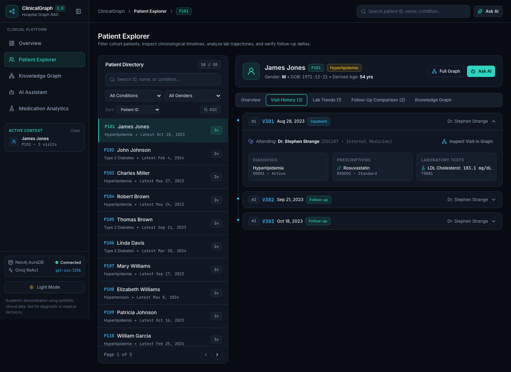
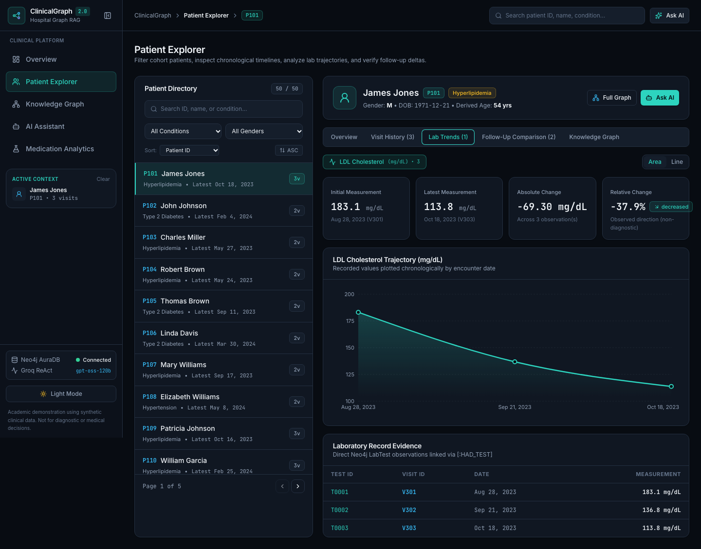
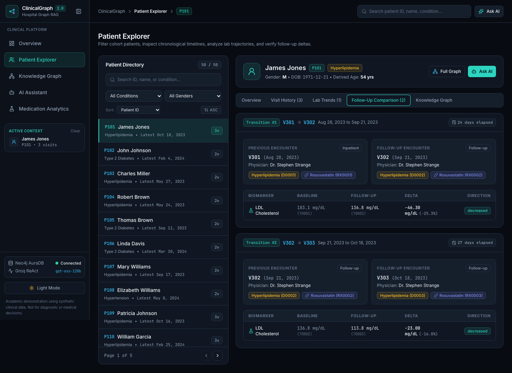
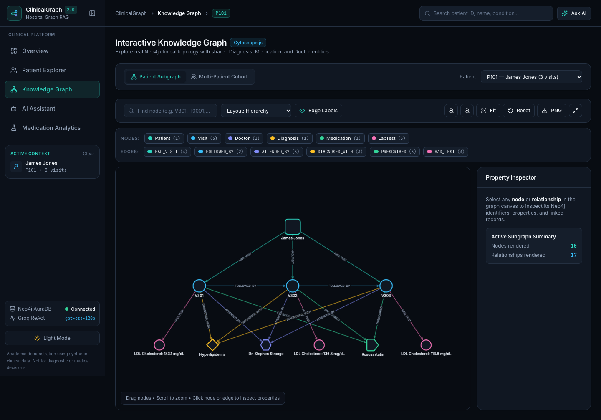
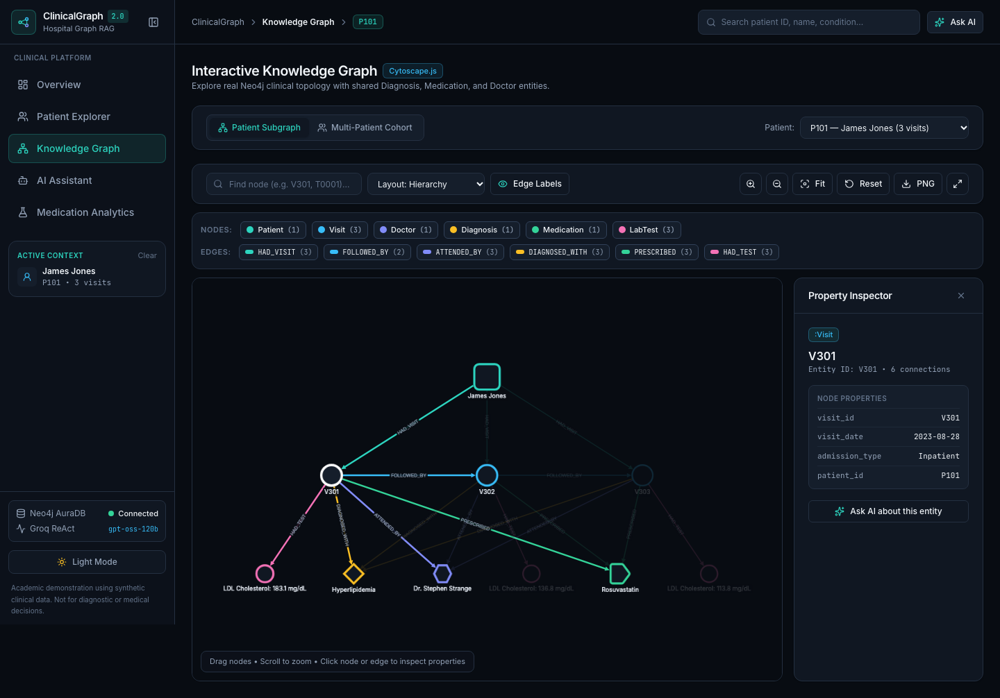
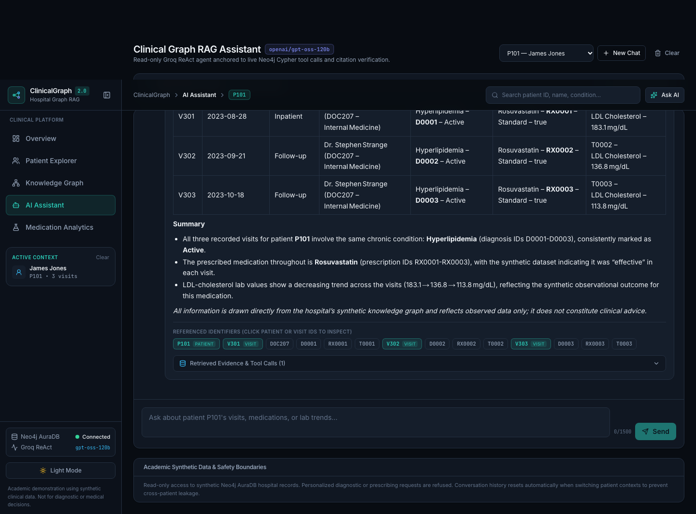
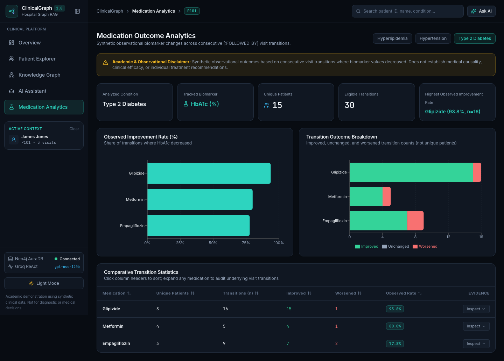
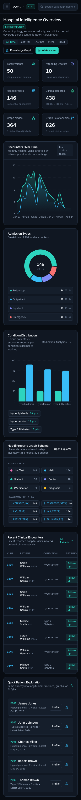

# ClinicalGraph 2.0 — Hospital Graph RAG & Clinical Intelligence Platform

[](https://www.python.org/downloads/)
[](https://fastapi.tiangolo.com/)
[](https://nextjs.org/)
[](https://neo4j.com/cloud/platform/auradb/)
[](https://groq.com/)

> **Academic Demonstration Notice:** This system is an academic demonstration developed on synthetic hospital data. It does not contain Protected Health Information (PHI) and is strictly not intended for clinical decision-making, individual diagnosis, or treatment prescription.

---

## 1. Executive Summary & Architecture

**ClinicalGraph 2.0** upgrades the original Streamlit Graph RAG prototype into a decoupled, cloud-deployable healthcare intelligence platform featuring a **Next.js App Router** dark-mode UI (`apps/web/`), a typed **FastAPI** REST layer (`backend/`), interactive **Cytoscape.js** knowledge graph exploration, **Recharts** longitudinal biomarker analytics, and the existing **Neo4j AuraDB + Groq ReAct** Graph RAG engine (`src/`).

The original Streamlit frontend (`frontend/app.py`) is preserved intact as a local fallback.

```
┌───────────────────────────────────────────────────────────────────────────┐
│                      Vercel — Next.js 15 Frontend (apps/web)              │
│   Overview • Patient Explorer • Knowledge Graph • AI Assistant • Meds     │
│   Server-Side Proxy Routes (/api/*) injecting X-Backend-Token             │
└────────────────────────────────────┬──────────────────────────────────────┘
                                     │ HTTPS + X-Backend-Token
                                     ▼
┌───────────────────────────────────────────────────────────────────────────┐
│                     Render — FastAPI Backend (backend/)                   │
│   Pydantic Schemas • Rate Limiting • Token Auth • Sanitized Errors        │
└──────────────┬──────────────────────────────────────────┬─────────────────┘
               │                                          │
               ▼                                          ▼
┌──────────────────────────────┐           ┌────────────────────────────────┐
│   Groq ReAct RAG Engine      │           │ Deterministic Graph Retrievals │
│   src/rag/engine.py          │──────────▶│ src/graph/retrieval.py         │
│   (openai/gpt-oss-120b)      │           │ (Read-Only Cypher Queries)     │
└──────────────────────────────┘           └──────────────┬─────────────────┘
                                                          │
                                                          ▼
                                           ┌────────────────────────────────┐
                                           │  Neo4j AuraDB Property Graph   │
                                           │  364 Nodes • 826 Relationships │
                                           └────────────────────────────────┘
```

---

## 2. Technology Stack

| Layer | Technologies |
| --- | --- |
| **Frontend (`apps/web`)** | Next.js 15.5 (App Router), React 19, TypeScript 5.9, Tailwind CSS 4, Radix UI primitives, Lucide icons, Motion, Recharts 3, Cytoscape.js 3.35, `react-markdown` |
| **Backend (`backend`)** | Python 3.12, FastAPI, Uvicorn, Pydantic v2, httpx |
| **Core RAG & Graph (`src`)** | Neo4j Python Driver 6.x, OpenAI Python SDK (Groq-compatible), `pandas`, `python-dotenv` |
| **Legacy Fallback (`frontend`)** | Streamlit, Plotly |
| **Cloud Targets** | Vercel (Next.js `apps/web`), Render (FastAPI root), Neo4j AuraDB, Groq Cloud |

---

## 3. Knowledge Graph Schema & Baseline Data

The read-only Neo4j AuraDB property graph stores **364 nodes** and **826 relationships** across 6 node labels and 6 relationship types:

- **Nodes:** `:Patient` (50), `:Doctor` (10), `:Visit` (146), `:Diagnosis` (3 shared conditions), `:Medication` (9 shared therapies), `:LabTest` (146)
- **Relationships:** `[:HAD_VISIT]` (146), `[:ATTENDED_BY]` (146), `[:DIAGNOSED_WITH]` (146), `[:PRESCRIBED]` (146), `[:HAD_TEST]` (146), `[:FOLLOWED_BY]` (96)
- **Clinical Records:** 438 total clinical event records (146 diagnoses + 146 prescriptions + 146 lab tests)

---

## 4. Visual Showcase (ClinicalGraph 2.0)

### Hospital Intelligence Overview


### Patient Explorer — Directory, Timeline, Lab Trends & Follow-Up Deltas





### Interactive Knowledge Graph & Property Inspector (Cytoscape.js)



### Clinical AI Assistant (Groq ReAct + Evidence Citations)


### Medication Outcome Analytics (Observational)


### Responsive Mobile Layout (390px)


---

## 5. Local Installation & Startup

### Prerequisites
- Python 3.12+ (with `.venv`)
- Node.js 20+ / 24+ and npm

### 1. Configure Environment Variables

Copy `.env.example` to `.env` at the repository root (backend) and `apps/web/.env.example` to `apps/web/.env.local` (frontend):

```bash
cp .env.example .env
cp apps/web/.env.example apps/web/.env.local
```

**Backend `.env` placeholders:**
- `NEO4J_URI=neo4j+s://<your-auradb-instance-id>.databases.neo4j.io`
- `NEO4J_USERNAME=neo4j`
- `NEO4J_PASSWORD=<your_neo4j_password>`
- `GROQ_API_KEY=<your_groq_api_key>`
- `ENVIRONMENT=development`
- `BACKEND_API_TOKEN=<optional-local-shared-secret>`
- `CORS_ORIGINS=http://localhost:3000,http://127.0.0.1:3000`

**Frontend `apps/web/.env.local` placeholders:**
- `BACKEND_URL=http://127.0.0.1:8000`
- `BACKEND_API_TOKEN=<matching-backend-token-if-set>`
- `DEMO_ACCESS_CODE=<optional-ui-passcode>`

### 2. Install Dependencies

```bash
# Python backend & core RAG dependencies
.venv/bin/pip install -r requirements.txt

# Next.js frontend dependencies
cd apps/web && npm install
```

### 3. Run Local Services

Run both backend and frontend together using the helper script:

```bash
./scripts/dev.sh
```

Or launch them in separate terminals:

```bash
# Terminal 1 — FastAPI Backend (http://127.0.0.1:8000, Swagger at /docs)
.venv/bin/python -m uvicorn backend.main:app --host 127.0.0.1 --port 8000

# Terminal 2 — Next.js Frontend (http://localhost:3000)
cd apps/web && npm run dev
```

### 4. Legacy Streamlit Fallback

```bash
.venv/bin/python -m streamlit run frontend/app.py
```

---

## 6. REST API Endpoints (`backend/`)

Interactive OpenAPI documentation is available locally at `http://127.0.0.1:8000/docs`.

| Method | Endpoint | Purpose |
| --- | --- | --- |
| `GET` | `/health` | Service, Neo4j connectivity, and Groq config status |
| `GET` | `/api/v1/overview` | Cohort KPIs, time-filtered visits, admission/condition breakdowns, recent encounters, schema counts |
| `GET` | `/api/v1/patients` | Searchable, filterable, sortable patient directory |
| `GET` | `/api/v1/patients/{patient_id}` | Demographics, derived age, visit bounds, conditions, doctors |
| `GET` | `/api/v1/patients/{patient_id}/timeline` | Chronological encounter timeline |
| `GET` | `/api/v1/patients/{patient_id}/lab-trends` | Longitudinal biomarker series and deltas |
| `GET` | `/api/v1/patients/{patient_id}/followups` | Consecutive `[:FOLLOWED_BY]` visit comparisons |
| `GET` | `/api/v1/patients/{patient_id}/graph` | Deduplicated Cytoscape subgraph for one patient |
| `GET` | `/api/v1/graph/cohort` | Multi-patient cohort subgraph showing shared doctors, diagnoses, and medications |
| `GET` | `/api/v1/conditions` | Tracked chronic conditions and primary biomarkers |
| `GET` | `/api/v1/analytics/medications` | Synthetic observational medication outcome metrics |
| `POST` | `/api/v1/chat` | Rate-limited Groq ReAct Graph RAG query with citations & audit trail |

---

## 7. Automated Testing & Verification

```bash
# Backend + Core Graph + RAG + Streamlit Regression Suite (93 tests)
.venv/bin/python -m pytest -q

# Frontend Unit/Component Tests, Lint, TypeScript, and Production Build
cd apps/web
npm test
npm run lint
npm run typecheck
npm run build
```

---

## 8. Cloud Deployment (Render + Vercel)

See [docs/DEPLOYMENT.md](docs/DEPLOYMENT.md) for complete step-by-step instructions, environment variable tables, and troubleshooting — including how splitting `apps/web` from the Python root resolves the previous `PYTHON_ENTRYPOINT_NOT_FOUND` Vercel error.

- **Render config:** [render.yaml](render.yaml)
- **Vercel root directory:** `apps/web` (Next.js App Router)

---

## 9. Security Model & Known Limitations

- **Credential Isolation:** `NEO4J_URI`, `NEO4J_PASSWORD`, `GROQ_API_KEY`, and `BACKEND_API_TOKEN` reside strictly on the server. Zero `NEXT_PUBLIC_` secrets are used.
- **Server-to-Server Auth:** When `ENVIRONMENT=production`, FastAPI fails closed unless `BACKEND_API_TOKEN` is configured and matched via `X-Backend-Token` / `Authorization: Bearer`.
- **Rate Limiting & Input Validation:** Sliding-window rate limiters guard `/api/v1/chat` (20/min default) and read routes (180/min default); `patient_id` inputs are regex-validated (`^P\d{2,6}$`), errors are sanitized against URI/key leakage, and no Cypher write or arbitrary query endpoints exist.
- **Observational & Academic Scope:** All clinical records are synthetic; medication comparisons reflect observational biomarker decreases and do not prove medical causality or clinical superiority. Not HIPAA-compliant or intended for real patient care.
