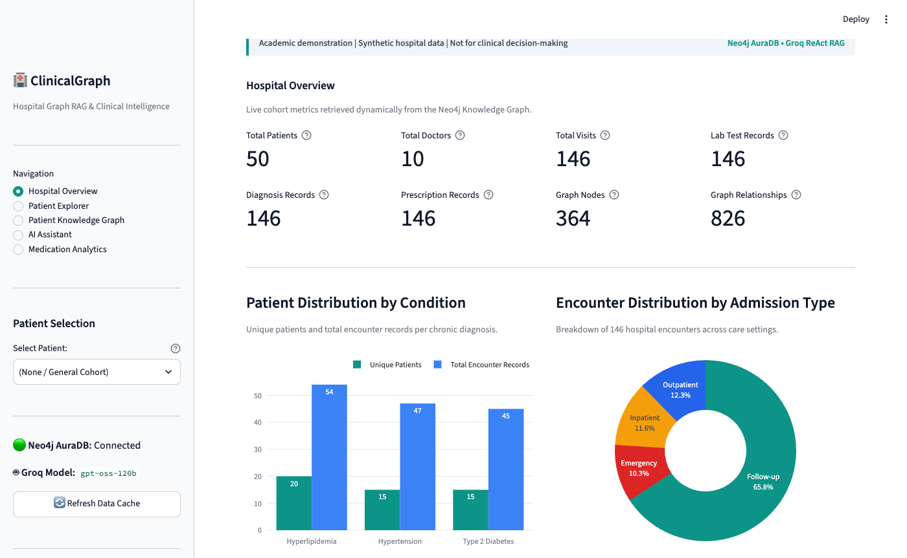
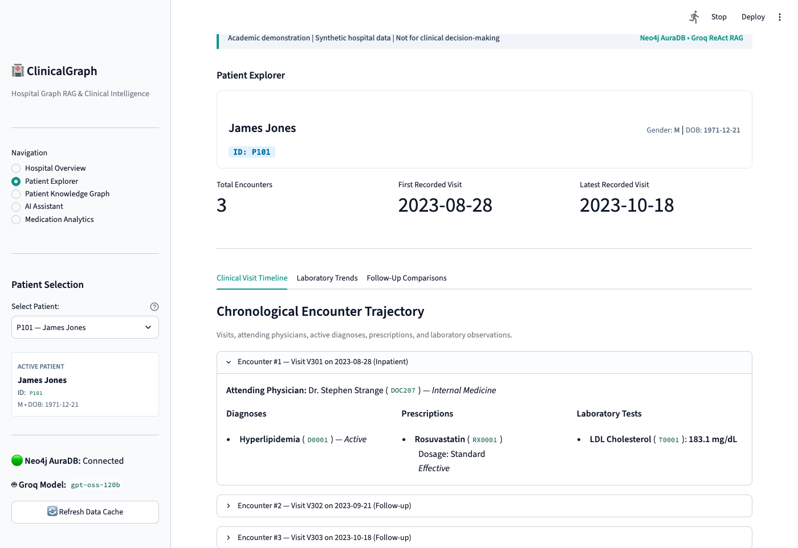
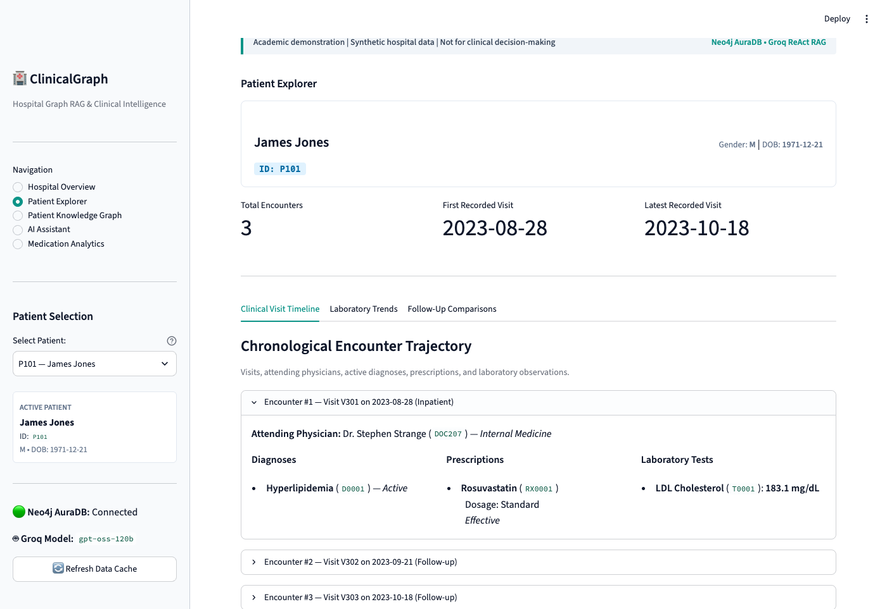
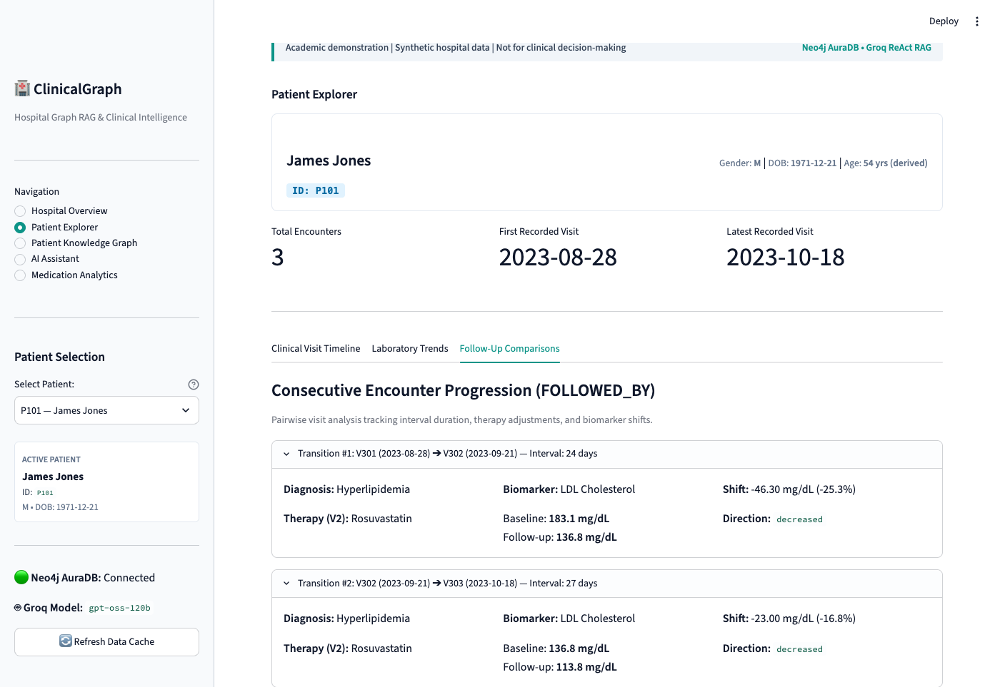
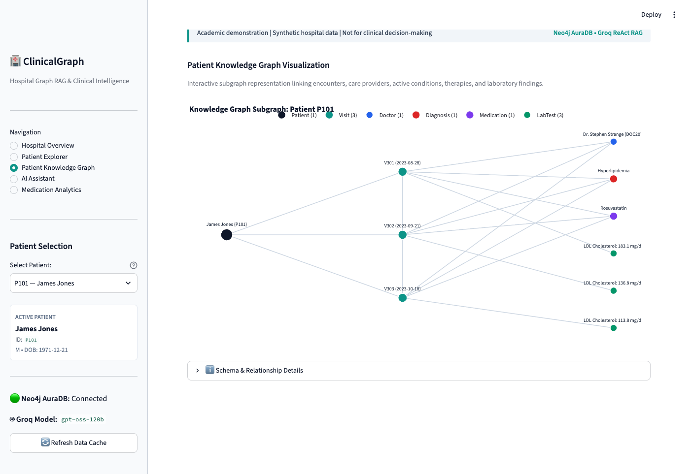
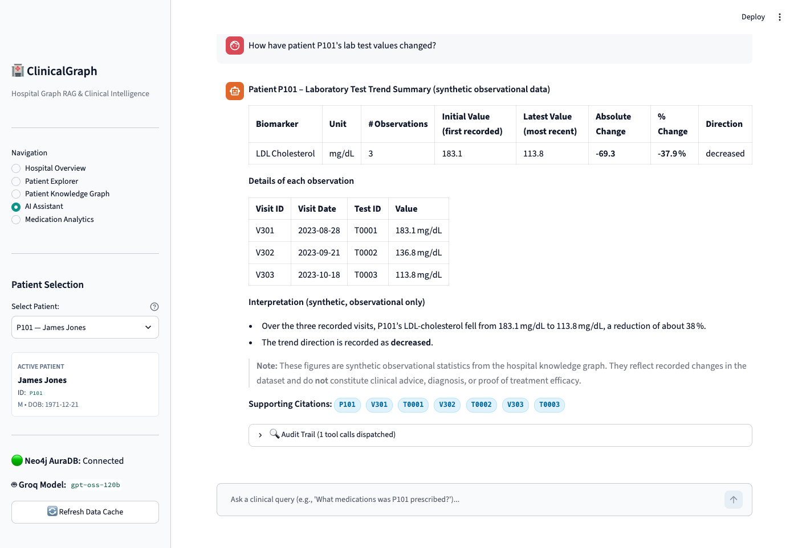
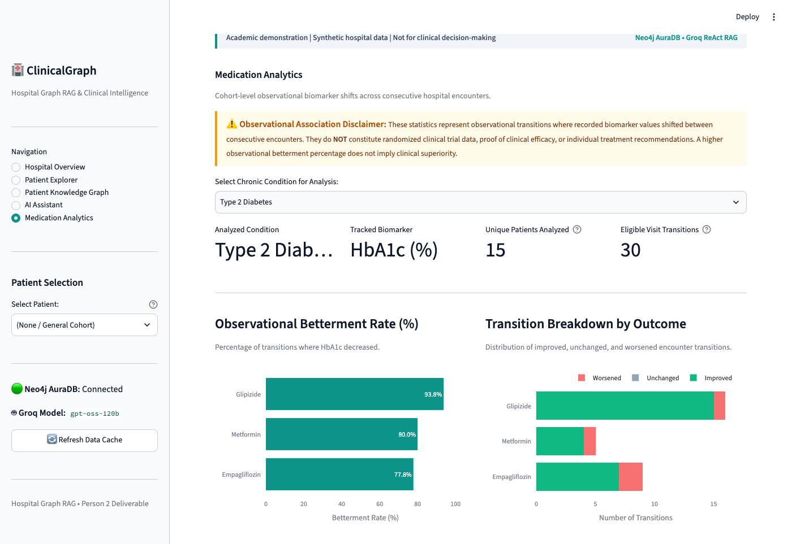

# ClinicalGraph — Hospital Graph RAG & Clinical Intelligence System

[](https://www.python.org/downloads/)
[](https://neo4j.com/cloud/platform/auradb/)
[](https://groq.com/)
[](https://streamlit.io/)
[]()

> **Academic Demonstration Notice:** This system is an academic demonstration developed on synthetic hospital data. It does not contain Protected Health Information (PHI) and is strictly not intended for clinical decision-making, individual diagnosis, or treatment prescription.

---

## 1. Executive Summary & Architecture

**ClinicalGraph** couples an expressive **Neo4j Property Graph** with a high-throughput **Groq ReAct Agent** (`openai/gpt-oss-120b`) and an interactive **Streamlit** clinical frontend.

Unlike traditional vector RAG systems that divide clinical records into unstructured text chunks, ClinicalGraph preserves the exact topological relationships between patients, clinical encounters, attending physicians, active diagnoses, longitudinal laboratory biomarkers, and pharmaceutical prescriptions.

```
                              ┌────────────────────────────────────────┐
                              │           Streamlit Frontend           │
                              │ (Hospital Overview, Patient Explorer,  │
                              │  AI Assistant, Medication Analytics)   │
                              └───────────────────┬────────────────────┘
                                                  │
                          ┌───────────────────────┴───────────────────────┐
                          │                                               │
                          ▼                                               ▼
              ┌───────────────────────┐                       ┌───────────────────────┐
              │ Groq ReAct RAG Engine │                       │ Direct Deterministic  │
              │  (openai/gpt-oss-120b)│                       │   Graph Retrievals    │
              └───────────┬───────────┘                       └───────────┬───────────┘
                          │                                               │
                          ▼                                               │
              ┌───────────────────────┐                                   │
              │ Parameterized Tools   │                                   │
              │ (Profile, Timeline,   │                                   │
              │  Trends, Follow-ups,  │◄──────────────────────────────────┘
              │  Medication Outcomes) │
              └───────────┬───────────┘
                          │ Strict Read-Only Cypher
                          ▼
              ┌───────────────────────────────────────────────────────────┐
              │                   Neo4j AuraDB Property Graph             │
              │     (364 Nodes, 826 Relationships, Zero Write Ops)        │
              └───────────────────────────────────────────────────────────┘
```

---

## 2. Knowledge Graph Schema

The property graph consists of **364 nodes** and **826 relationships** structured across 6 canonical node labels and 6 relationship types:

### Node Labels
| Node Label | Count | Primary Key | Description |
| :--- | :--- | :--- | :--- |
| `:Patient` | 50 | `patient_id` | Patient demographics (`name`, `dob`, `gender`) |
| `:Doctor` | 10 | `doctor_id` | Attending physicians (`name`, `specialty`) |
| `:Visit` | 146 | `visit_id` | Hospital encounters (`visit_date`, `admission_type`) |
| `:Diagnosis` | 3 | `condition` | Shared chronic conditions (Type 2 Diabetes, Hypertension, Hyperlipidemia) |
| `:Medication` | 9 | `name` | Shared pharmaceutical therapies (e.g., Metformin, Lisinopril, Rosuvastatin) |
| `:LabTest` | 146 | `test_id` | Individual quantitative laboratory measurements (`value`, `unit`, `test_name`) |

### Relationships
| Relationship Type | Count | Traversal Topology | Key Properties |
| :--- | :--- | :--- | :--- |
| `[:HAD_VISIT]` | 146 | `(:Patient)-[:HAD_VISIT]->(:Visit)` | Encounter ownership |
| `[:ATTENDED_BY]` | 146 | `(:Visit)-[:ATTENDED_BY]->(:Doctor)` | Clinical provider linkage |
| `[:DIAGNOSED_WITH]` | 146 | `(:Visit)-[:DIAGNOSED_WITH]->(:Diagnosis)` | `diagnosis_id`, `status` (`Active`, `Resolved`) |
| `[:PRESCRIBED]` | 146 | `(:Visit)-[:PRESCRIBED]->(:Medication)` | `prescription_id`, `dosage`, `is_effective` |
| `[:HAD_TEST]` | 146 | `(:Visit)-[:HAD_TEST]->(:LabTest)` | Diagnostic measurement linkage |
| `[:FOLLOWED_BY]` | 96 | `(:Visit)-[:FOLLOWED_BY]->(:Visit)` | Consecutive longitudinal encounter transitions |

---

## 3. Advanced Graph Retrieval Tools

The RAG engine dispatches deterministic Python retrieval tools implemented in `src/graph/retrieval.py`:

1. **`get_patient_directory()`**: Returns all 50 patients for cataloging and fuzzy search.
2. **`get_patient_profile(patient_id)`**: Demographics, encounter count, and temporal date bounds.
3. **`get_patient_timeline(patient_id)`**: Chronological list of all visits with attending doctors, active diagnoses, prescriptions, and lab tests.
4. **`get_lab_trends(patient_id, test_name=None)`**: Grouped biomarker observations tracking initial, latest, delta values, percentage shift, and trajectory direction.
5. **`get_followup_comparison(patient_id)`**: Pairwise analysis between consecutive encounters (`[:FOLLOWED_BY]`), calculating elapsed days and biomarker deltas.
6. **`get_medication_outcomes(condition)`**: Cohort-wide transition analysis reporting betterment rates, outcome distributions (`improved`/`worsened`/`unchanged`), and sample sizes.
7. **`get_hospital_overview_stats()`**: Macro-level cohort metrics, condition frequencies, and admission distributions.
8. **`get_best_medications_for_condition(condition)`**: Backward-compatible wrapper for legacy analytics.

---

## 4. Frontend Application & Interactive Features

The application provides a modular, professional healthcare interface styled with a Clinical Teal and Deep Navy design system.

### Page Views
1. **Hospital Overview:** Live cohort counts, condition distributions (Bar Chart), and encounter admission distributions (Donut Chart).
2. **Patient Explorer:** Patient demographics header with dynamically derived age from DOB, chronological encounter trajectory cards, quantitative biomarker line charts, and pairwise follow-up comparison cards.
3. **Patient Knowledge Graph:** 2D interactive network visualization with node deduplication, entity color coding, and edge midpoint hover inspection displaying relationship names, record IDs, status, and dosages.
4. **Clinical AI Assistant:** Conversational ReAct interface with active patient context injection, multi-turn conversational follow-up memory, color-coded citation badges, grounding warning alerts, and transparent retrieval audit trails.
5. **Medication Analytics:** Observational biomarker shifts across consecutive visits, betterment rate horizontal bar charts, stacked transition outcome distributions, and neutral observational metrics with explicit sample size indicators.

---

## 5. Visual Documentation & Screenshots

### Hospital Overview
Macro cohort metrics, condition distributions, and system architecture.


### Patient Explorer
Longitudinal encounter trajectory and attending physician details for Patient P101 (James Jones).


### Quantitative Laboratory Trends
Longitudinal LDL Cholesterol trajectory line chart across consecutive encounters.


### Follow-Up Progression Comparison
Pairwise encounter comparison over consecutive visits connected via `[:FOLLOWED_BY]`.


### Patient Knowledge Graph Subgraph
2D network layout representing deduplicated Doctor, Diagnosis, and Medication entities with individual LabTest nodes.


### Clinical AI Assistant
Conversational interface with active patient context, citation validation pills, and transparent tool call audit trails.


### Medication Analytics
Cohort-level observational betterment rates, transition breakdown distributions, and observational disclaimers.


---

## 6. Installation & Quickstart

### Prerequisites
- macOS / Linux / Windows
- Python 3.12+ (managed via `uv` or standard `python3.12`)
- Git

### 1. Clone Repository & Setup Virtual Environment
```bash
git clone https://github.com/hospital-graph-rag-team/hospital-graph-rag.git
cd hospital-graph-rag
git checkout feat/person2-clinical-rag

# Create and activate virtual environment
python3.12 -m venv .venv
source .venv/bin/activate
pip install -r requirements.txt
```

### 2. Configure Environment Variables
Copy `.env.example` to `.env` and supply valid Neo4j and Groq credentials:
```bash
cp .env.example .env
```
Edit `.env`:
```ini
NEO4J_URI=neo4j+s://<your-auradb-instance>.databases.neo4j.io
NEO4J_USERNAME=neo4j
NEO4J_PASSWORD=<your-database-password>
GROQ_API_KEY=gsk_<your-groq-api-key>
```

### 3. Launch the Streamlit Frontend
```bash
.venv/bin/python -m streamlit run frontend/app.py
```
Open [http://localhost:8501](http://localhost:8501) in your browser.

---

## 7. Automated Test Suite & Verification

The repository contains **83 automated unit and integration tests** passing with 100% pass rate. All tests execute fully offline without requiring active cloud credentials or internet connectivity.

```bash
# Run complete test suite (83 tests)
.venv/bin/python -m pytest -q

# Run offline verification without .env credentials
mv .env .env.bak
.venv/bin/python -m pytest -q
mv .env.bak .env

# Run data validation script
.venv/bin/python src/data_generation/validate_data.py

# Run graph verification script (requires live Neo4j credentials)
.venv/bin/python src/graph/verify_graph.py
```

### Test Suite Structure
- `tests/test_data_validation.py` (16 tests): Schema integrity, key constraints, orphan references, date validity.
- `tests/test_verify_graph.py` (8 tests): Graph topological parity, trajectory chronological consistency, live connection.
- `tests/test_retrieval.py` (18 tests): Cypher retrieval functions, JSON serialization, timelines, overview stats.
- `tests/test_rag_engine.py` (18 tests): ReAct execution loop, tool schemas, safety refusals, argument validation.
- `tests/test_frontend.py` (9 tests): Streamlit AppTest headless navigation, node deduplication, patient isolation.
- `tests/test_phase7_regression.py` (14 tests): Derived age calculation, relationship midpoints, transition reconciliation, failure handling.

---

## 9. Data Pipeline & Ingestion Architecture

The project data pipeline moves from synthetic cohort generation to automated validation and Neo4j graph construction:

```
┌─────────────────────────┐       ┌─────────────────────────┐       ┌─────────────────────────┐
│   Data Generation       │       │    Data Validation      │       │     Neo4j Ingestion     │
│   (Faker & Clinical     │ ───►  │   (Schema, Keys,        │ ───►  │   (Read-Only Driver,    │
│    Distributions)       │       │    Orphans, Dates)      │       │    Unique Constraints)  │
│ `data/raw/*.csv`        │       │ `validate_data.py`      │       │ `src/graph/load*.py`    │
└─────────────────────────┘       └─────────────────────────┘       └─────────────────────────┘
```

1. **Generation (`src/data_generation/`):** Generates 50 synthetic patients across 10 attending physicians, producing 146 clinical encounters (`visits.csv`), 146 diagnoses (`diagnoses.csv`), 146 medication orders (`prescriptions.csv`), and 146 laboratory panels (`lab_tests.csv`).
2. **Comprehensive Validation (`validate_data.py`):** Enforces 16 integrity checks across all 6 raw CSVs: primary key uniqueness, foreign key referential integrity (zero orphan visits, doctors, or patients), valid calendar ranges (no visit before birth dates, sorted visit dates per patient), and physiologically plausible laboratory ranges.
3. **Graph Ingestion (`src/graph/`):** Populates the Neo4j AuraDB property graph with nodes and relationships, creating uniqueness constraints and building longitudinal `[:FOLLOWED_BY]` relationship chains between consecutive patient encounters.

---

## 10. Known Limitations & Architectural Considerations

### 1. Diagnosis Uniqueness Constraint Schema Limitation
In the Neo4j AuraDB instance, a uniqueness constraint was originally configured on `Diagnosis.diagnosis_id`. However, the graph schema model merges `(:Diagnosis)` nodes on the clinical `condition` string (e.g., `Type 2 Diabetes`, `Hypertension`, `Hyperlipidemia`), creating **3 shared canonical Diagnosis nodes** across the entire hospital cohort rather than 146 individual diagnosis event nodes.
- **Consequence:** The `diagnosis_id` stored on the `(:Diagnosis)` node itself reflects only one of the encounter IDs encountered during initial ingestion.
- **Resolution in ClinicalGraph:** True encounter-level `diagnosis_id` values and encounter-specific statuses (`Active`, `Resolved`) are stored directly on the `[:DIAGNOSED_WITH]` relationship (`(:Visit)-[:DIAGNOSED_WITH {diagnosis_id, status}]->(:Diagnosis)`). All retrieval functions in `src/graph/retrieval.py` query the relationship properties to preserve 100% record-level fidelity.

### 2. Observational Nature of Synthetic Medication Data
All medication outcome statistics (betterment rates, biomarker shifts) are calculated from observational comparisons of consecutive encounters (`[:FOLLOWED_BY]`). 
- **Consequence:** These metrics reflect synthetic retrospective associations within an observational cohort.
- **Resolution in ClinicalGraph:** They are explicitly not randomized controlled trial (RCT) results, causal proofs, or clinical recommendations. Both the frontend dashboard and the AI Assistant surface prominent neutral disclaimers and sample sizes (`N`) alongside all outcome percentages.

---

## 11. Repository Structure

```
hospital-graph-rag/
├── .env.example                     # Environment template (Neo4j & Groq placeholders)
├── .gitignore                        # Git exclusion rules (.env, .venv, scratch, pycache)
├── README.md                         # Comprehensive project documentation & architecture
├── requirements.txt                  # Python dependency specifications
├── data/
│   └── raw/                          # 6 canonical synthetic CSV datasets
│       ├── patients.csv              # 50 patient demographics
│       ├── doctors.csv               # 10 attending physicians
│       ├── visits.csv                # 146 hospital encounters
│       ├── diagnoses.csv             # 146 diagnostic records
│       ├── prescriptions.csv         # 146 pharmaceutical orders
│       └── lab_tests.csv             # 146 quantitative laboratory panels
├── docs/
│   └── screenshots/                  # Verified unique application screenshots
│       ├── 01_hospital_overview.png  # Cohort KPIs & condition distributions
│       ├── 02_patient_explorer.png   # Encounter timeline & physician details
│       ├── 03_patient_lab_trends.png # Longitudinal LDL/HbA1c line charts
│       ├── 04_patient_followup.png   # Pairwise follow-up comparison cards
│       ├── 05_knowledge_graph.png    # Interactive 2D PyVis network graph
│       ├── 06_ai_assistant.png       # Conversational Groq ReAct interface
│       └── 07_medication_analytics.png# Cohort observational betterment rates
├── frontend/                         # Streamlit clinical dashboard
│   ├── __init__.py                   # Package marker
│   ├── app.py                        # Streamlit main entrypoint & navigation
│   ├── styles.py                     # Design system (Clinical Teal & Deep Navy CSS)
│   └── components/                   # Modular view components
│       ├── __init__.py               # Package marker
│       ├── dashboard.py              # Hospital Overview view
│       ├── patient_view.py           # Patient Explorer (Timeline, Trends, Follow-up)
│       ├── graph_viewer.py           # Patient Knowledge Graph (2D PyVis visualization)
│       ├── chat_interface.py         # Clinical AI Assistant with citation pills
│       └── analytics_view.py         # Medication Analytics & observational charts
├── src/                              # Core backend logic
│   ├── __init__.py                   # Package marker
│   ├── data_generation/              # Synthetic data generators & validators
│   │   ├── __init__.py               # Package marker
│   │   ├── generate_data.py          # Synthetic generation logic
│   │   └── validate_data.py          # 16-point comprehensive CSV data validator
│   ├── graph/                        # Neo4j connection & graph retrieval
│   │   ├── __init__.py               # Package marker
│   │   ├── connection.py             # Read-only Neo4j AuraDB driver singleton
│   │   ├── retrieval.py              # 8 deterministic Cypher retrieval tools
│   │   └── verify_graph.py           # Graph topological verification script
│   └── rag/                          # AI & RAG Engine
│       ├── __init__.py               # Package marker
│       ├── engine.py                 # Groq ReAct agent & tool calling loop
│       ├── prompts.py                # System instructions & medical guardrails
│       └── tools.py                  # Declarative tool schemas for Groq LLM
└── tests/                            # Automated test suite (83 tests)
    ├── test_data_validation.py       # 16 CSV schema & referential integrity tests
    ├── test_verify_graph.py          # 8 Neo4j graph parity tests
    ├── test_retrieval.py             # 18 Cypher retrieval & serialization tests
    ├── test_rag_engine.py            # 18 ReAct loop, safety, & refusal tests
    ├── test_frontend.py              # 9 Streamlit AppTest headless navigation tests
    └── test_phase7_regression.py     # 14 UI component & edge case regression tests
```

---

## 12. Safety, Security & Ethical Boundaries

1. **Strict Read-Only Operations:** The system operates exclusively with read-only Cypher semantics (`MATCH`, `RETURN`). No write or mutation operations (`CREATE`, `MERGE`, `SET`, `DELETE`, `DROP`) are permitted.
2. **Medical Advice Safeguards:** The AI Assistant deterministically intercepts requests for personalized diagnosis, drug prescriptions, or personal medical advice, refusing execution and directing users to licensed clinicians.
3. **Database Deletion Restrictions:** Pre-LLM safety regex checks intercept attempts to drop or delete records (0.00ms latency).
4. **Prompt Injection Defense:** Model system instructions and input sanitizers prevent credential extraction or system prompt leakage.
5. **Context Isolation:** Selecting a different patient immediately flushes conversation history in session state, preventing cross-patient clinical data leakage.
6. **Observational Data Clarity:** All medication outcome metrics are explicitly labeled as synthetic observational associations, not causal proofs of clinical efficacy.
